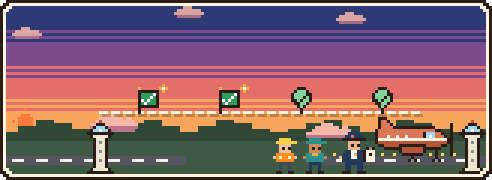

# Flight Plan

A live map of what Claude is doing, beside the chat in the Claude desktop app. Claude files the job as a
route of stops and steps, and a little 8-bit plane flies it. The sky goes from sunrise to sunset as steps
actually get done. You can change any step or choice on the map, and Claude picks up the change on its very
next move.

Built for people who build with Claude Code without reading every tool call.



## Install

In a Claude Code terminal session, type:

```
/plugin install flightplan --marketplace aravinth01/flightplan
```

Answer `y` to add the marketplace, then pick the user scope. From then on every new Claude Code session
(including the desktop app's Code tab) loads Flight Plan.

## What's new

- **2.0.0, Pixel Skies**:
  - **The sky:** an animated 8-bit airfield sits at the top of the map. Claude is the pixel captain, and
    helpers are the crew. The sky runs from sunrise to sunset as steps close, and only then.
  - **Boarding passes:** each stop on the route gets a boarding pass.
  - **Words:** the map talks in a light gen-z voice, or in plain words if you prefer.
  - **Honest landings:** confetti only when every step has receipts.
  - **Sounds:** new 8-bit ones.
- **1.0.0**: first public release.
  - The live map, the departure countdown, and click-to-change steps and choices.
  - Progress based on evidence (file writes and test runs), with honest "done, not tested" marks.
  - Sounds and the `/flight` command.

## What you'll see

| | |
| --- | --- |
|  | **Now boarding.** Before Claude starts, the whole route is laid out at dawn: every stop is a pin. A 30-second countdown gives you time to change anything. |
|  | **In the air.** The plane flies the step Claude is on. It moves only when the map sees the work (a file written, a test run) or Claude reports it. |
|  | **Bumpy air.** When the tests fail three times in a row, a storm rolls in, and you get two buttons: **Try another way** or **Skip this step**. |
|  | **Touchdown.** Every step checked by a test the map saw pass gets confetti and a cheering crew. That's a "we ate" landing. |
|  | **Landed.** Some steps were never tested. The captain lands with a clipboard: no confetti, just how many steps still have no receipts. |

The clock on the sky is **not** a real clock and never an ETA. It shows how much of the route is done.

## Using it

Ask Claude for anything that takes a few steps. Before it edits a file, Claude files the route and the map
opens beside the chat:

- **NOW BOARDING**: the whole route, with a 30-second countdown.
  - Click any step to rename, skip or remove it. Opening a step pauses the clock.
  - **Hold, let me look** stops the clock; **Take off now** starts the flight.
  - Small jobs (three steps or fewer) and plans you approved in plan mode take off at once.
- **IN THE AIR**: what Claude is doing, in plain words.
  - The stop Claude is on opens as a boarding pass: where it's flying from and to, its steps, and a chip on
    each step.
  - **details** shows files and commands.
- **YOUR TURN**: Claude asked you something; answer in the chat. The plane circles with a **?** and a soft
  knock plays.
- **BUMPY AIR**: the tests failed three runs in a row; **Try another way** or **Skip this step**.
- **HOLDING PATTERN**: Claude stopped with steps open; **Continue**, or **Ask Claude to update the map**.
- **TAKING FIVE**: you paused the flight; Claude finishes the step it is on and stops.
- **TOUCHDOWN / LANDED**: every step is done. Steps without receipts can be checked with one press.

Every change you make shows a badge until Claude confirms it: **queued**, then **sent to Claude**, then
**Claude has it**. Your wording, order and removals always win over Claude's.

`/flight` opens the map. `/flight go`, `/flight hold`, `/flight pause`, `/flight show`, `/flight details`
and `/flight sound off` do what they say.

### What the chips mean

| Chip (fun / plain) | Meaning |
| --- | --- |
| `receipts ✅` / `checked` | a test the map saw pass, after the step's work |
| `done, no receipts yet` / `done, not tested yet` | the work happened, but no test covered it |
| `done (Claude's word)` / `done, Claude says` | Claude says it is done; the map did not see proof |
| `you checked it ✓` / `you checked it` | you signed it off yourself (your word, not a test) |
| `done? tests say nope` / `done? last test failed` | the last test run after this step failed |
| `<>` | a choice Claude made without asking you; press review to keep or switch it |
| `~ queued` | your change, not yet read by Claude |

"Receipts" only ever means one thing: a test the map saw pass. Confetti, the fanfare and "we ate" happen
only when every step has them (or you skipped it).

## Settings

In the config menu (`/config`), under Flight Plan:

| Setting | Values | Default |
| --- | --- | --- |
| Words | `fun` (a little gen-z), `plain` (plain friendly words) | `fun` |
| Animations | `full` (the pixel sky), `calm` (text marks, no animation) | `full` |
| Departure | `countdown`, `go` (wait for Take off), `auto` (start at once) | `countdown` |
| Countdown seconds | any number from 5 | 30 |
| Sounds | `all`, `important` (the knock and landings only), `off` | `all` |

## How it works

- Claude gets one tool, `route`, with five operations:
  - `set`: file the route, each step naming the files it will touch and how it will be checked
  - `step`: report progress
  - `patch`, `decide`, `get`
- The map does not rely on Claude reporting every step. In testing, Claude filed its plan before editing in
  every run, but rarely reported step boundaries on its own. So the plane follows evidence: writes to a
  step's declared files, and test runs the map sees pass or fail.
- The sky is one small animated picture (about 9 KB), redrawn only when something real happens: the plane
  moves, a step gets receipts, a landing. Otherwise the same picture keeps running.
- Your changes reach Claude in the result of its next tool call, or with your next message when it is idle.
- The voice setting changes only what you read. What Claude reads is the same plain text in both.

Design notes and test results: `docs/v2-design.md`, `docs/spike-results.md` and `docs/spec.html`.

## Developing

Clone the repo, then install it from your local folder, so your edits load after `/reload-plugins`:

```bash
git clone https://github.com/aravinth01/flightplan ~/Projects/flightplan
```

```bash
claude plugin marketplace add ~/Projects/flightplan
```

```bash
claude plugin install flightplan@flightplan --scope user
```

Check and test it:

```bash
claude plugin validate ~/Projects/flightplan
```

```bash
claude plugin test ~/Projects/flightplan
```

Set `FLIGHTPLAN_LOG=/path/to/file.json` to have the route written out after each turn.

## License

MIT, © 2026 Sree Aravinth V.
